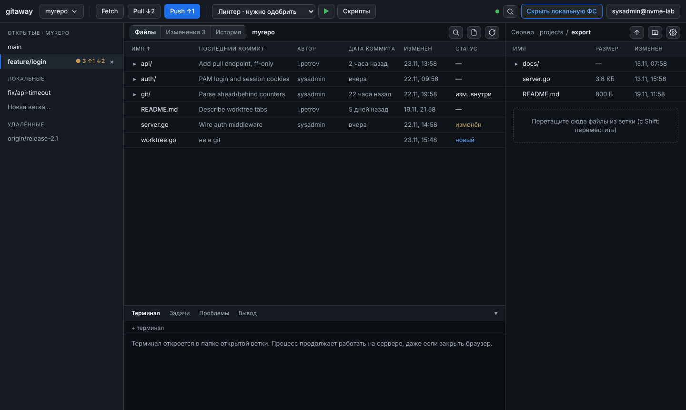
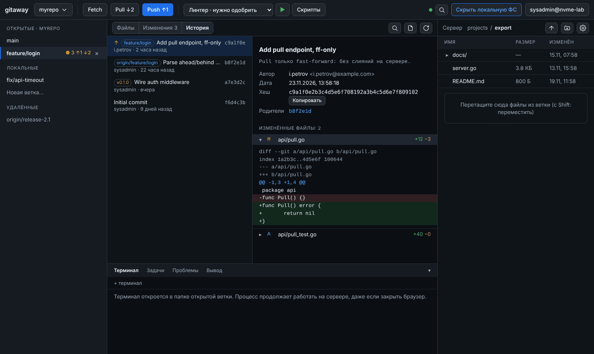
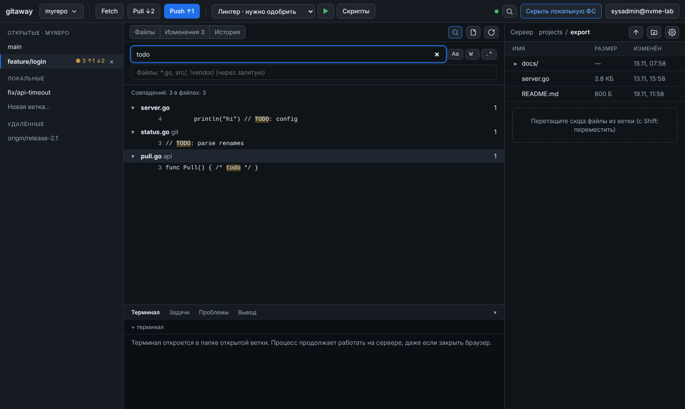
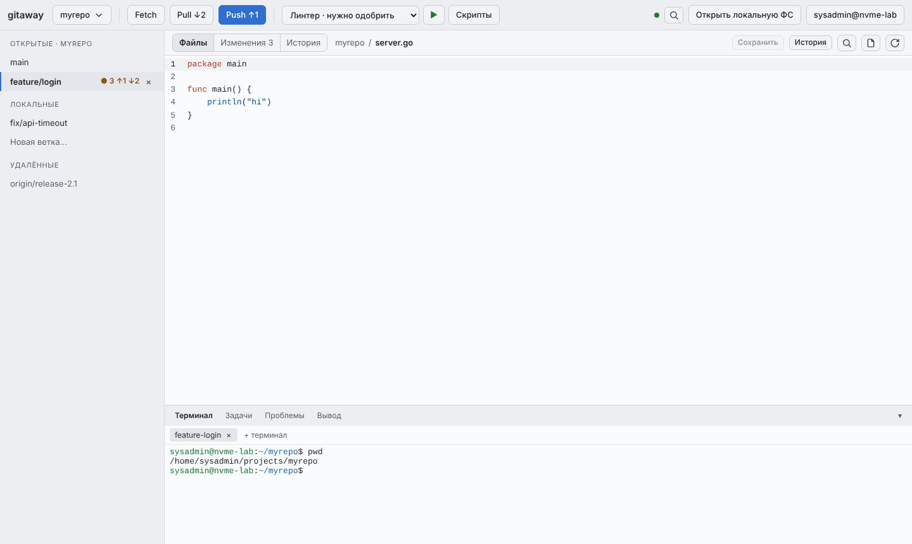
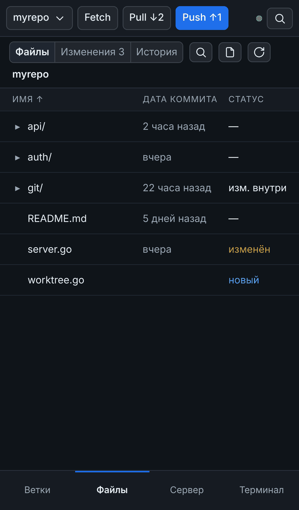

<div align="center">

# gitaway

**A lightweight web UI for git and files on your server.**
One Go binary, opens in a browser on any device, including your phone.

[](https://github.com/Maxi-Boy/gitaway/actions/workflows/ci.yml)
[](LICENSE)


[Русский](README.md) · English



</div>

## Why

code-server gives you a full VS Code in the browser, but it weighs hundreds of megabytes.
gitaway covers everyday work with code on a server: branches, editing, commits, builds
and tests. It is a single binary of about 8 MB that runs as a regular user, like a
terminal after an SSH login.

## Features

- **Several branches at once.** Each open branch has its own working folder (`git worktree`),
  changes and terminal. Fetch, Pull (fast-forward only) and Push are separate, with ↑ahead
  and ↓behind counters. You can merge, create and delete branches.
- **File table** with the last commit, author, commit date, modification time and git status.
- **Editor** (CodeMirror 6): syntax highlighting, search, go to line. Unsaved edits survive
  a lost connection.
- **Quick open** (Ctrl+P) and **project search** (Ctrl+Shift+F) with case, whole word,
  regex and file filters.
- **Changes and history:** stage, commit and diff. Browse branch, file or folder history and
  view each commit's diff. Unpushed commits are marked.
- **Server panel:** drag files from a branch to a server folder, with a step-by-step
  conflict dialog.
- **Terminal** that keeps running on the server after you close the browser.
- **Tasks with one ▶ button:** detected from Makefile, go.mod, package.json, Cargo.toml
  and pytest. You can also save your own scripts or keep tasks in `.gitaway.json`
  (they run only after you trust the file).
- **GitHub deploy keys** for private repositories, with no passwords or tokens.
- **Phone layout**, Russian and English, dark and light theme, command palette (Ctrl+K).

| | |
|---|---|
|  |  |
|  | <p align="center"></p> |

## Install

You need Go 1.23+ and git 2.28+. The build works offline: Go modules are vendored, and
the editor and terminal live in `web/vendor/`.

```sh
sudo dnf install golang git pam-devel      # RED OS / Fedora / RHEL
git clone https://github.com/Maxi-Boy/gitaway.git && cd gitaway
make build-pam                              # or `make build` for one-time token login
sudo cp bin/gitaway /usr/local/bin/
mkdir -p ~/.config/gitaway && cp config.example.json ~/.config/gitaway/config.json
sudo cp packaging/pam.d-gitaway /etc/pam.d/gitaway     # for "auth_mode": "pam"
sudo cp packaging/gitaway@.service /etc/systemd/system/
sudo systemctl daemon-reload && sudo systemctl enable --now gitaway@$USER
```

By default gitaway listens on `127.0.0.1:8450`. To reach it over HTTPS, put nginx in front
of it (see [`packaging/nginx-gitaway.conf`](packaging/nginx-gitaway.conf)) and set
`"trust_proxy": true`. To limit client addresses, use `allow_cidrs`. Repositories and files
are reachable only inside `roots`.

With PAM, only the user that runs gitaway can sign in, using their normal password.
gitaway refuses to run as root.

## Security

All request paths are confined to `roots`. git runs without a shell, and branch names,
remotes and URLs are validated first. Changing requests need a session, a CSRF token and
a matching Origin. The UI uses a strict CSP and loads nothing from third-party sites.
Details are in [`docs/DECISIONS.md`](docs/DECISIONS.md) (in Russian).

## Development

```sh
make check            # gofmt, go vet, tests (needs git)
go test -race ./...
```

The backend uses the standard library plus three dependencies (pty, WebSocket, PAM).
The frontend is plain ES modules with no build step. UI checks are in `tools/uicheck`.

## License

[MIT](LICENSE)
