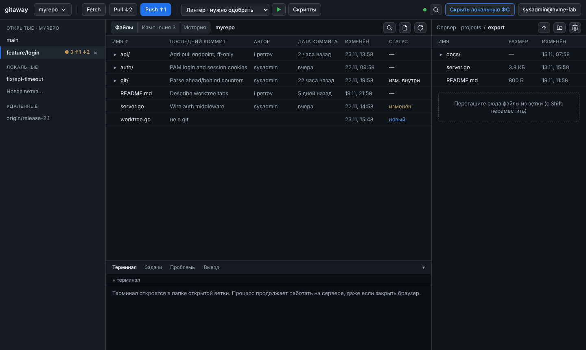
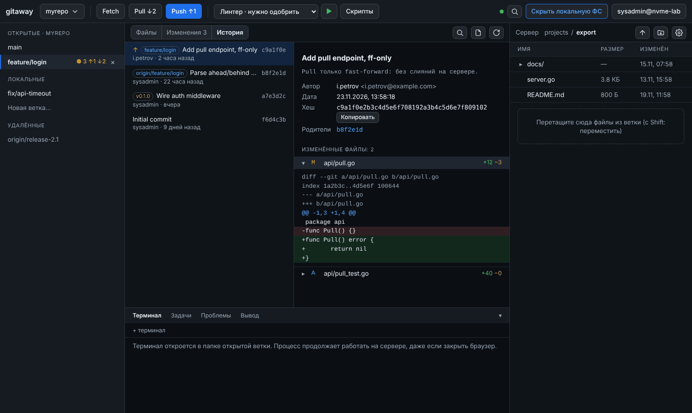
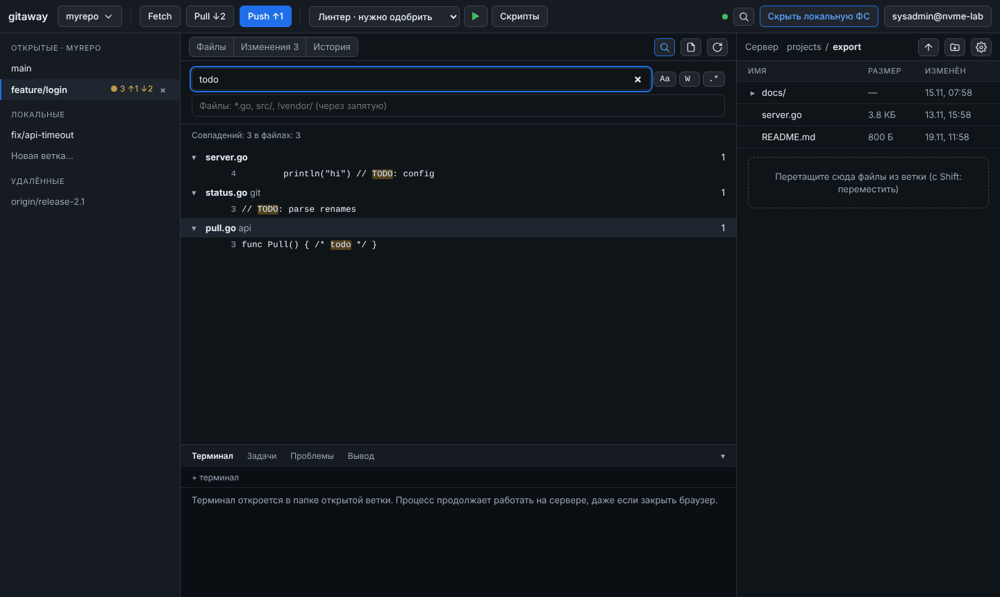
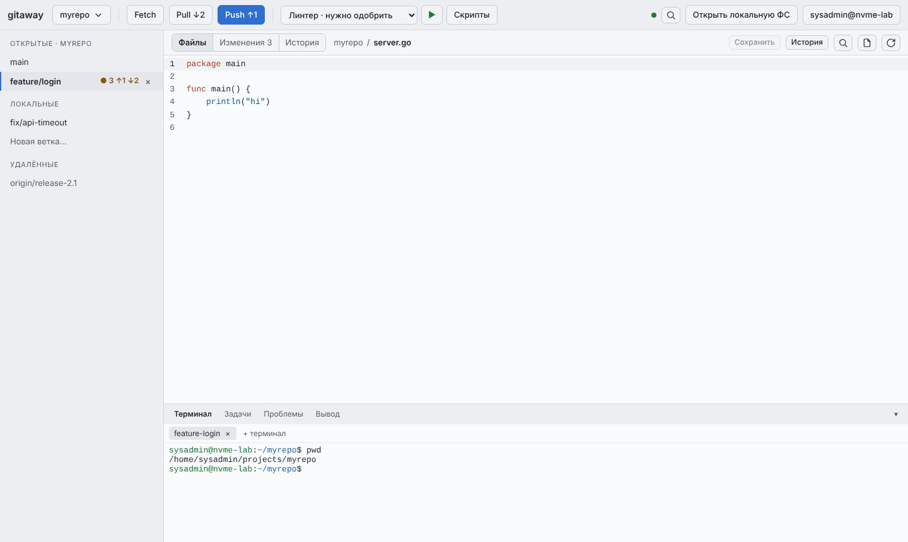
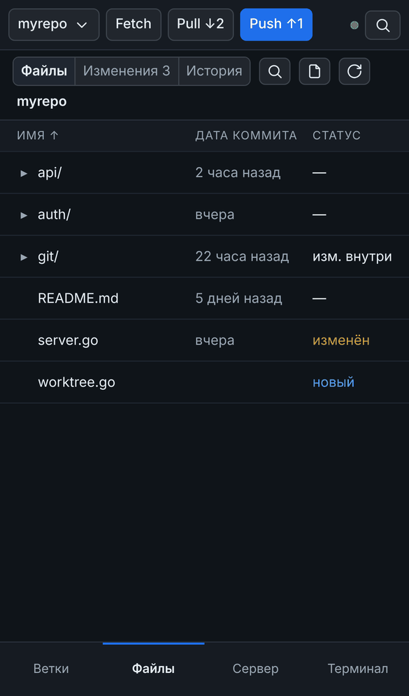

<div align="center">

# gitaway

**Лёгкий веб-интерфейс для git и файлов на сервере.**
Один бинарник на Go, открывается в браузере с любого устройства, в том числе с телефона.

[](https://github.com/Maxi-Boy/gitaway/actions/workflows/ci.yml)
[](LICENSE)


Русский · [English](README.en.md)



</div>

## Зачем

code-server даёт полноценный VS Code в браузере, но весит сотни мегабайт и тянет за собой
целую среду. gitaway закрывает повседневную работу с кодом на сервере: ветки, правка файлов,
коммиты, сборка и тесты. Это один файл размером около 8 МБ, который запускается от имени
обычного пользователя, как терминал после входа по SSH.

## Возможности

**Ветки**
- Несколько веток открыты одновременно: у каждой своя рабочая папка (`git worktree`),
  свои изменения и свой терминал. Переключение между ними не трогает незакоммиченную работу.
- Fetch, Pull и Push всегда отдельными кнопками, со счётчиками ↑ ahead и ↓ behind.
  Pull только fast-forward.
- Слияние веток, удаление локальных и удалённых веток, создание новой ветки.

**Файлы и код**
- Таблица файлов: последний коммит, автор, дата коммита, дата изменения на диске, статус git.
- Редактор CodeMirror 6 с подсветкой синтаксиса, поиском и переходом к строке.
  Несохранённая правка переживает обрыв связи, чужие изменения файла не затираются молча.
- Быстрое открытие файла по части имени (Ctrl+P) и поиск по всему проекту (Ctrl+Shift+F)
  с учётом регистра, целыми словами, регулярными выражениями и фильтром файлов.

**Изменения и история**
- Stage, unstage, отмена изменений, коммит, diff каждого файла.
- История ветки, файла или папки. У каждого коммита видны описание, автор,
  изменённые файлы и их diff. Неотправленные коммиты отмечены.

**Сервер**
- Серверная панель (скрыта по умолчанию): файлы можно перетаскивать из ветки в любую
  разрешённую папку сервера. Если файлы уже есть, открывается пошаговый диалог конфликтов:
  заменить, пропустить или сохранить оба.

**Терминал, задачи, скрипты**
- Терминал в браузере (xterm.js). Процесс живёт на сервере: можно закрыть браузер,
  открыть его на телефоне и увидеть накопленный вывод.
- Задачи одной кнопкой ▶. Команды определяются автоматически из `Makefile`, `go.mod`,
  `package.json`, `Cargo.toml` и pytest. Можно сохранить свои цепочки команд (сборка,
  бэкап папки) или описать задачи в файле `.gitaway.json` в репозитории.
- Ctrl+Shift+B повторяет последнюю задачу, итог виден рядом с веткой (✓ или ✗).

**GitHub**
- Закрытые репозитории подключаются через deploy-ключ: gitaway создаёт ключ, вы добавляете
  его на GitHub, gitaway проверяет доступ. Пароли и токены нигде не хранятся.

**Интерфейс**
- Адаптивная вёрстка: на телефоне одна колонка и переключатель
  «Ветки / Файлы / Сервер / Терминал», ряд клавиш Esc, Tab и Ctrl для терминала.
- Русский и английский язык, тёмная и светлая тема (или как в системе).
- Палитра команд (Ctrl+K): любое действие можно найти по названию.
- Адрес в браузере отражает экран, поэтому работают «Назад», закладки и ссылки на файл со строкой.

<table>
  <tr>
    <td width="50%"></td>
    <td width="50%"></td>
  </tr>
  <tr>
    <td align="center">История ветки и diff коммита</td>
    <td align="center">Поиск по проекту</td>
  </tr>
  <tr>
    <td width="50%"></td>
    <td width="50%" align="center"></td>
  </tr>
  <tr>
    <td align="center">Светлая тема: редактор и терминал</td>
    <td align="center">На телефоне</td>
  </tr>
</table>

## Установка

Нужны Go 1.23 или новее и git 2.28 или новее. Сборка не ходит в интернет: зависимости Go
лежат в `vendor/`, редактор и терминал в `web/vendor/`. Ниже пример для RED OS и других
RPM-дистрибутивов.

```sh
sudo dnf install golang git pam-devel
git clone https://github.com/Maxi-Boy/gitaway.git
cd gitaway
make build-pam                  # bin/gitaway со входом по паролю учётной записи
sudo cp bin/gitaway /usr/local/bin/
```

Без `pam-devel` можно собрать `make build`: тогда вход будет по одноразовому токену,
который программа печатает при запуске. Такой режим удобен для пробы и разработки.

### Настройка

```sh
mkdir -p ~/.config/gitaway ~/projects
cp config.example.json ~/.config/gitaway/config.json
```

| Поле | По умолчанию | Что значит |
|---|---|---|
| `listen` | `127.0.0.1:8450` | Адрес и порт. По умолчанию только локально, наружу через nginx |
| `roots` | `["~/projects"]` | Папки, внутри которых доступны репозитории и файлы. Всё остальное закрыто |
| `default_folder` | `~/projects/export` | Папка, которую серверная панель открывает первой |
| `data_dir` | `~/.config/gitaway` | Список репозиториев, настройки, deploy-ключи |
| `auth_mode` | `token` | `pam`: вход паролем учётной записи; `token`: одноразовый токен |
| `session_ttl` | `12h` | Сколько живёт вход |
| `trust_proxy` | `false` | `true`, если перед gitaway стоит nginx (cookie с флагом Secure) |
| `allow_cidrs` | `[]` | С каких адресов можно подключаться, например `["10.0.0.0/8"]`. Пусто: с любых |

### Вход паролем (PAM)

```sh
sudo cp packaging/pam.d-gitaway /etc/pam.d/gitaway
```

В `config.json` поставьте `"auth_mode": "pam"`. Войти можно только под тем пользователем,
от имени которого запущен gitaway, и с его обычным паролем. Запуск от root запрещён.

### Запуск как служба

```sh
sudo cp packaging/gitaway@.service /etc/systemd/system/
sudo systemctl daemon-reload
sudo systemctl enable --now gitaway@$USER
```

### Доступ по HTTPS через nginx

Готовый пример с поддержкой WebSocket для терминала лежит в
[`packaging/nginx-gitaway.conf`](packaging/nginx-gitaway.conf). Укажите в нём сертификат
и порт, а в `config.json` поставьте `"trust_proxy": true`.

## Задачи в репозитории

Файл `.gitaway.json` в корне репозитория добавляет задачи для всей команды. gitaway
показывает его содержимое и запускает задачи только после вашего подтверждения. Если файл
меняется, gitaway спрашивает снова.

```json
{
  "tasks": [
    { "name": "Тесты", "steps": ["go test -race ./..."] },
    { "name": "Сборка", "steps": ["make build", "ls -la bin/"], "timeout": "10m" }
  ]
}
```

В шагах можно использовать подстановки `{worktree}`, `{repo}`, `{branch}`, `{date}` и `{time}`.
Значения подставляются в кавычках, поэтому имя ветки не выполнится как команда.

## Клавиши

| Клавиши | Действие |
|---|---|
| Ctrl+K | Палитра команд |
| Ctrl+P | Открыть файл по имени (`main.go:40` открывает на строке 40) |
| Ctrl+Shift+F | Поиск по проекту (выделенный в редакторе текст подставляется сам) |
| Ctrl+Shift+G / Ctrl+Shift+H | Изменения / история ветки |
| Ctrl+S | Сохранить файл |
| Ctrl+\` | Новый терминал |
| Ctrl+Shift+B | Повторить последнюю задачу |
| Ctrl+J | Журнал операций git |
| Ctrl+Shift+E | Серверная панель |
| Alt+PageUp / Alt+PageDown | Предыдущая / следующая открытая ветка |

Внутри терминала сочетания вроде Ctrl+P и Ctrl+K остаются оболочке.

## Безопасность

- Любой путь из запроса проверяется: выйти за пределы `roots` нельзя, symlink наружу
  не пропускаются, папку `.git` копировать нельзя.
- git вызывается напрямую, без оболочки, аргументы передаются списком. Имена веток,
  remote и адреса проверяются до вызова.
- Изменяющие запросы требуют сессию, CSRF-токен и совпадение Origin. Попытки входа ограничены.
- Строгая CSP (`default-src 'self'`), интерфейс не загружает ничего со сторонних сайтов.
- Пароли, токены и учётные данные в адресах remote не попадают в журнал.

Подробности в [`docs/DECISIONS.md`](docs/DECISIONS.md).

## Разработка

```sh
make check                      # gofmt, go vet, тесты (нужен git)
go test -race ./...
make build && ./bin/gitaway -config config.json
```

- Бэкенд работает на стандартной библиотеке Go. Внешних зависимостей три: pty, WebSocket и PAM.
- Фронтенд собран из обычных ES-модулей без фреймворка и без шага сборки.
- Интерфейс проверяется в `tools/uicheck`: это заглушка API и сценарий Playwright.
  Снимки для этого README делает `tools/uicheck/shots.cjs`.
- План развития лежит в [`docs/ROADMAP.md`](docs/ROADMAP.md).

## Лицензия

[MIT](LICENSE)
